# AutoLearn
## Software educativo de autómatas finitos

**Informe técnico, manual de usuario y evidencias de validación**

**Aplicación en línea:** [https://automataeducativo.netlify.app/](https://automataeducativo.netlify.app/). La versión publicada se utiliza desde el navegador sin instalar dependencias. Las evidencias incluidas más adelante corresponden a las pruebas locales documentadas.

| Dato | Información |
| --- | --- |
| Integrantes | [Completar] |
| Institución | [Completar] |
| Docente | [Completar] |
| Asignatura | Teoría de la Computación |
| Microproyecto | Construcción, determinización y minimización de autómatas finitos |
| Fecha de evidencias | 15 de noviembre de 2026 |

## 1. Presentación

AutoLearn permite construir autómatas desde expresiones regulares y registrar autómatas manualmente. Clasifica la entrada, determina un AFD equivalente cuando corresponde, elimina estados inaccesibles y obtiene un AFD mínimo. El usuario consulta diagramas, tablas, explicaciones y recorridos de cadenas.

Este informe se contrasta con el archivo `MICROPROYECTO1-AF.pdf`, cuyo título interno es «Microproyecto #3». Las evidencias automáticas y de navegador corresponden a una ejecución local de la aplicación compilada, sin despliegue externo.

## 2. Análisis y casos de uso

**Objetivo general:** apoyar el aprendizaje de autómatas finitos mediante transformaciones implementadas por el equipo y explicaciones consultables de los resultados intermedios.

**Usuario principal:** estudiante o docente que desea construir, transformar o comprobar un autómata. No se requiere registro de cuenta.

| Caso de uso | Entrada y acción | Resultado |
| --- | --- | --- |
| CU-01 Construir desde lenguaje | Registrar Σ y expresión; pulsar Generar | Thompson, AFD determinizado y mínimo |
| CU-02 Analizar autómata | Registrar Q, Σ, q0, F y δ; analizar | Clasificación explicada y minimización |
| CU-03 Comparar etapas | Elegir Inicial, Determinizado o AFD Mínimo | Tabla y grafo de la etapa seleccionada |
| CU-04 Explicar transformación | Abrir Paso a paso y elegir algoritmo | Operaciones, correspondencias y particiones |
| CU-05 Verificar cadena | Elegir un AFD, ingresar cadena y avanzar | Recorrido y aceptación o rechazo |
| CU-06 Corregir entrada | Registrar datos inválidos | Mensaje que identifica el error |

### Correspondencia con los requisitos

| Código | Implementación o evidencia |
| --- | --- |
| RF-01 | Alphabet / Alfabeto; pruebas de vacío, duplicados y ε reservado |
| RF-02 | Parser con validación de símbolos, operadores y paréntesis |
| RF-03 | Construcción de Thompson en ambos motores |
| RF-04 | Formulario manual y validaciones de estados y transiciones |
| RF-05 | Clasificador y razones de determinismo/no determinismo |
| RF-06 | Construcción de subconjuntos y clausuras ε |
| RF-07 | Búsqueda de accesibles y poda previa a minimizar |
| RF-09 | Refinamiento de Moore sobre AFD completo |
| RF-10 | Bitácoras de Thompson, subconjuntos y minimización |
| RF-11 | Tabla y diagrama SVG de la etapa mínima |
| RF-12 | Simulación de AFD, recorrido y veredicto |
| RF-13 | Navegación entre etapas y consulta de trazas |

El PDF omite RF-08. RF-06 dice literalmente «Convertir un AFN a AFND equivalente»; se interpreta como determinización AFND → AFD, conforme a la descripción, los objetivos y el procesamiento esperado del mismo documento.

## 3. Instalación y ejecución

La web requiere Node.js y npm. Desde la raíz del repositorio:

```bash
npm install
npm run dev
```

Abrir la dirección que indique Vite. Para producción:

```bash
npm run build
npm run preview
```

La compilación genera `dist/`. El motor Python se valida con Python 3 y los comandos del apartado de pruebas. La interfaz alternativa se inicia con `python3 gui_tkinter.py` y requiere Tkinter disponible en el sistema; no se validó su interacción en esta sesión.

La configuración de Netlify está incluida en `netlify.toml`: compilación `npm run build` y publicación de `dist`. Las evidencias de este informe corresponden a ejecución local.


## 4. Diseño técnico y algoritmos


### Alcance y entradas

El sistema construye y minimiza autómatas desde expresiones regulares (modalidad A) o desde componentes registrados manualmente (modalidad B). La aplicación web ejecuta los algoritmos en TypeScript en el navegador. El repositorio también contiene un motor Python y una interfaz Tkinter.

El alfabeto se ingresa separado por comas o espacios, por ejemplo `a, b`. Se rechazan alfabetos vacíos, duplicados y el símbolo reservado `ε`. Para trabajar con expresiones y cadenas se deben utilizar símbolos de un carácter: el procesamiento consume caracteres y no implementa tokens de varias letras.

Las expresiones admiten unión `|`, concatenación implícita `ab` o explícita `a.b`, estrella `*` y paréntesis. La precedencia es estrella, concatenación y unión. Por ejemplo, `(a|b)*ab` representa las cadenas que terminan en `ab`. Los alias `+` y `U` representan unión cuando no son símbolos del alfabeto; `∪` también representa unión. No se utiliza la sintaxis general de expresiones regulares de JavaScript: no se admiten clases como `[a-z]` ni cuantificadores como `{2}`.

En modalidad B se ingresan Q y F como listas separadas por comas, un único estado inicial y transiciones con origen, símbolo y destino. El inicial y los finales deben pertenecer a Q; cada transición debe referirse a estados registrados y a un símbolo del alfabeto o ε. F puede estar vacío. Se admiten AFD parciales, AFND y ε-AFND.

### Estructuras de datos

`src/core/Automata.ts` representa los estados mediante `Map<string, Estado>`, los finales mediante `Set<string>` y las transiciones mediante `Map<string, Map<string, Set<string>>>`. Los conjuntos evitan destinos duplicados y permiten representar no determinismo. Cada estado almacena identificador, marcas de inicio y aceptación y, cuando corresponde, sus estados de procedencia en `subEstados`.

`Alphabet` encapsula los símbolos y sus validaciones. `PedagogicalTracer` registra etapas, mensajes, correspondencias y particiones. Los resultados de simulación incluyen aceptación, pasos y mensaje final. En Python se utilizan diccionarios y conjuntos con el mismo propósito.

### Algoritmos implementados

1. **Análisis de expresiones:** el parser valida los símbolos y la estructura, introduce concatenaciones y convierte a notación posfija con una pila de operadores.
2. **Thompson:** una pila de fragmentos construye el ε-AFND. Unión, concatenación y estrella conectan fragmentos mediante transiciones ε.
3. **Clasificación:** las transiciones ε identifican ε-AFND; varios destinos para un mismo par estado/símbolo identifican AFND. En ausencia de ambos, se considera AFD, incluso si hay transiciones faltantes.
4. **Subconjuntos:** calcula la clausura ε inicial y explora conjuntos alcanzables mediante movimientos por símbolo y sus clausuras. Cada conjunto produce un estado con correspondencia a los originales.
5. **Accesibilidad:** una búsqueda desde el inicial identifica los estados alcanzables; los restantes se eliminan de una copia del autómata.
6. **Minimización de Moore:** primero elimina inaccesibles y completa transiciones faltantes con un estado de rechazo. Inicia con finales y no finales, divide grupos según sus destinos a otros grupos y repite hasta estabilizar. Cada bloque estable produce un estado mínimo. No se utiliza la optimización de Hopcroft.
7. **Simulación:** recorre un AFD símbolo a símbolo y acepta si termina en F tras consumir toda la cadena. Registra el recorrido. La web indica que se debe seleccionar Determinizado o AFD Mínimo cuando la etapa actual es no determinista; ambos motores rechazan llamadas directas al simulador con AFND.

Si la entrada ya es determinista, se informa su clasificación y se continúa con la minimización sin ejecutar subconjuntos. La interfaz permite consultar las etapas inicial, determinizada cuando corresponde y mínima, además de las trazas de los algoritmos.

### Arquitectura y bibliotecas

- **React y React DOM:** formularios, navegación entre etapas y actualización de resultados.
- **SVG del navegador:** dibujo del grafo, flechas y estados; `GraphViewer` calcula posiciones y permite arrastrar nodos. No construye ni minimiza autómatas.
- **Lucide React:** iconos de los controles.
- **Tailwind CSS, PostCSS y Autoprefixer:** estilos y procesamiento de CSS.
- **TypeScript y Vite:** comprobación de tipos, servidor de desarrollo y compilación estática a `dist`.
- **Tkinter:** interfaz alternativa de escritorio para el motor Python.

Los algoritmos están implementados en `src/algorithms` y `algorithms`; no se delegan a una biblioteca de autómatas. La web puede ejecutarse sin un servidor Python. `bridge.py` adapta entradas y resultados del motor Python para sus consumidores.

### Validación y entrega

Las instrucciones de instalación están en el [README](../README.md), el manual de ambas modalidades en [EJERCICIOS_MANUALES.md](EJERCICIOS_MANUALES.md) y la matriz de pruebas en [VALIDACION.md](VALIDACION.md).

Para la sustentación: construir `(a|b)*ab`, mostrar la clasificación y subconjuntos, explicar las particiones del AFD mínimo y simular `aab` y `aba`; después cargar los ejemplos manuales de AFND con ε y AFD redundante. Verificar también la poda con el ejemplo de inaccesibles. Los resultados esperados están en el manual.

La entrega debe incorporar las capturas obtenidas en una sesión real y la exposición del equipo. El uso del mismo lenguaje que en microproyectos anteriores requiere confirmación del equipo; no se puede deducir de este repositorio.


## 5. Manual y ejemplos resueltos


Inicia con `npm run dev` y abre la dirección que indique Vite.
En cada caso selecciona **AFD Mínimo**, entra en **Probar cadena**, pulsa **Probar** y luego **Siguiente** hasta ver el veredicto. Para probar la cadena vacía deja el campo vacío, sin escribir ε.

Los nombres de estados pueden variar; compara cantidad, transiciones y aceptación.

### 1. Cadenas que terminan en ab

Modalidad **Expresión Regular**. Alfabeto: `a, b`. Expresión: `(a|b)*ab`. Pulsa **Generar**.

- AFD mínimo: **3 estados**.
- Acepta: `ab`, `aab`, `bab`, `abab`.
- Rechaza: cadena vacía, `a`, `aba`, `abb`.
- Repite con `(a|b)*.a.b`: debe aceptar exactamente las mismas cadenas.

Tabla esperada, usando nombres ilustrativos:

| Estado | a | b |
| --- | --- | --- |
| → S0 | S1 | S0 |
| S1 | S1 | S2 |
| ★ S2 | S1 | S0 |

### 2. Cualquier cantidad de letras a

Alfabeto: `a, b`. Expresión: `a*`.

- AFD mínimo completo: **2 estados**, incluido el estado de rechazo.
- Acepta: cadena vacía, `a`, `aa`, `aaaa`.
- Rechaza: `b`, `ab`, `ba`.
- El estado inicial debe ser también final.

### 3. AFND con épsilon

En **Autómata Manual**, pulsa el ejemplo **AFND con ε** y luego **Analizar y minimizar**.

Datos del ejemplo: alfabeto `0, 1`; estados `A, B, C`; inicial `A`; final `C`.

| Origen | Símbolo | Destino |
| --- | --- | --- |
| A | ε | B |
| A | 0 | A |
| B | 1 | C |
| C | 0 | C |

- Debe clasificarse como **ε-AFND**.
- AFD mínimo completo: **3 estados**, incluido rechazo.
- Acepta: `1`, `01`, `0010`, `100`.
- Rechaza: cadena vacía, `0`, `11`, `0101`.
- En **Paso a paso → Subconjuntos**, revisa que la clausura inicial contenga A y B.

### 4. Fusión de estados equivalentes

En **Autómata Manual**, pulsa **AFD redundante** y **Analizar y minimizar**.

- Entrada: **5 estados**, clasificación **AFD**.
- Salida mínima: **4 estados**.
- C y D deben quedar en un mismo estado mínimo; revisa su correspondencia en la tabla o bitácora.
- Acepta: `aa`, `ab`, `aab`, `abb`.
- Rechaza: cadena vacía, `a`, `b`, `ba`, `bbb`.
- La etapa de determinización debe omitirse porque la entrada ya es determinista.

### 5. Eliminación de inaccesibles

En **Autómata Manual**, pulsa **Con inaccesibles** y **Analizar y minimizar**.

- `q_inacc` debe desaparecer del resultado y figurar en la explicación de poda.
- AFD mínimo completo: **4 estados**; acepta únicamente `01`.
- Acepta: `01`.
- Rechaza: cadena vacía, `0`, `1`, `010`, `001`.
- Aunque el estado inaccesible desaparece, se agrega el estado de rechazo para completar transiciones; por eso el número final también es cuatro.

### 6. Validaciones de errores

Prueba cada entrada por separado:

| Modalidad | Entrada | Resultado esperado |
| --- | --- | --- |
| Expresión Regular | Alfabeto `a, a` | Error por duplicados |
| Expresión Regular | Alfabeto `a, ε` | Error por símbolo reservado |
| Expresión Regular | Alfabeto `a, b`; expresión `ac` | Error por símbolo ajeno |
| Expresión Regular | `a|`, `()`, `*a`, `a..b`, `(a` | Error de sintaxis |
| Autómata Manual | Inicial `Z` sin incluirlo en Q | Error de estado inicial |
| Autómata Manual | Q `A,B`; inicial `A`; finales `Z` | Error: el estado final Z no pertenece a Q |
| Autómata Manual | Agrega una transición hacia `Z` sin incluirlo en Q | Error de destino |
| Simulador | En el ejercicio 1 introduce `abc` | Rechazo por símbolo ajeno |

### Comprobación visual

- Alterna entre Inicial, Determinizado y AFD Mínimo: tabla y grafo deben corresponder a la etapa elegida.
- Revisa el indicador de inicio y los estados finales en tabla y grafo.
- Arrastra un nodo: las flechas deben acompañarlo.
- Consulta las trazas de Thompson, Subconjuntos y Minimización cuando estén disponibles.
- Simula sobre el **AFD mínimo** para estos ejercicios. Si seleccionas la etapa inicial de un AFND, el panel debe indicar que selecciones Determinizado o AFD Mínimo y no ofrecer un veredicto de aceptación o rechazo.
- En una pantalla estrecha, verifica que puedas acceder a formularios, botones y tabla.

Registra para cada ejercicio: resultado observado, resultado esperado y captura si difieren. Esta guía contiene resultados esperados; no certifica que los clics hayan sido ejecutados en un navegador.


## 6. Matriz y método de validación


Revisión inicial realizada el 14 de noviembre de 2026 y correcciones ampliadas el 15 de noviembre. El PDF se titula internamente «Microproyecto #3».

### Ejecución reproducible

```bash
npm test
npm run build
python3 test_runner.py
python3 -m unittest discover -s tests -v
```

Todos estos comandos finalizaron correctamente en esta revisión.

### Matriz de pruebas

| Requisito | Caso y evidencia automatizada | Resultado |
| --- | --- | --- |
| RF-01 | Alfabeto vacío, duplicados y ε reservado (`npm test`) | Rechazados |
| RF-02 | Concatenación `ab` y `a.b`; símbolos ajenos y expresiones mal formadas | Validación correcta en ambos motores |
| RF-03, RF-06 | Thompson y subconjuntos para catorce expresiones, incluyendo estrella y unión | Lenguaje conservado |
| RF-04, RF-05 | Casos Python: ε-AFND manual y AFD redundante | Clasificación esperada |
| RF-04 | Estados finales ajenos a Q, en validación TypeScript y entrada Python | Rechazados con mensaje que identifica el estado |
| RF-12 | Simulación directa de AFND con bifurcaciones y ε en ambos motores | Se solicita utilizar un AFD |
| RF-07 | Estado final inaccesible en autómata de lenguaje vacío | Eliminado sin alterar la entrada |
| RF-09 | `(a|b)*ab` | Tres estados mínimos |
| RF-09 | AFD parcial sin estados finales alcanzables | Un único estado mínimo completo |
| RF-09 | Entrada no determinista enviada directamente al minimizador | Error que solicita determinizar |
| RF-12 | 3.570 cadenas de longitud 0 a 7 comparadas con expresiones regulares nativas de JavaScript | Todas coinciden |
| RF-12 | Casos Python: `aab`, `aba`, `0010`, `11` | Aceptación/rechazo esperado |
| Compilación | TypeScript y build de producción Vite | Correctos |

Se prueban 14 expresiones en cada motor con las 255 cadenas sobre {a,b} de longitud hasta siete (3.570 comparaciones por motor): `(a|b)*ab`, `(a|b)*.a.b`, `a*`, `a|b`, `(ab)*`, `a`, `ab`, `a|ab`, `(a|b)*`, `(a*)*`, `a*b*`, `(a|bb)*`, `a(b|a)*b` y `((a|b)(a|b))*`.

#### Pruebas ampliadas del 15 de noviembre

- Cada motor genera 100 AFND con semilla 20261115, cinco estados, transiciones ε, ciclos y transiciones faltantes. Los conjuntos generados en JavaScript y Python son diferentes porque sus generadores son diferentes.
- Un evaluador independiente explora configuraciones `(estado, posición)` del AFND original, sin usar los algoritmos de clausura ni subconjuntos del producto. Se comparan sus resultados con el AFD determinizado y con el mínimo para las 63 cadenas de longitud hasta cinco: 12.600 comparaciones por motor.
- Se comprueba que cada estado mínimo tenga exactamente un destino por símbolo, que minimizar de nuevo conserve la cantidad de estados y que el autómata original no sea alterado.
- Se prueban nombres potencialmente ambiguos (`A_B` frente a los estados `A` y `B`, y `A,B` como identificador directo del motor), entradas manuales inválidas, finales vacíos, cadena vacía, bloqueos y símbolos fuera del alfabeto.
- Se comprueban los alias de unión `+`, `U` y `∪`, además de expresiones con espacios, tabulaciones y saltos de línea.
- La suite Python contiene 12 métodos de prueba con múltiples casos internos; los tres escenarios académicos también se ejecutan por separado.

Estas comprobaciones suman 32.340 comparaciones de aceptación entre ambos motores, además de las validaciones y regresiones específicas. Todas finalizaron correctamente tras las correcciones.

### Correcciones aplicadas

- Se admite el punto de concatenación explícita documentado en ambos parsers.
- Se rechazan paréntesis vacíos, operadores sin operandos y expresiones incompletas antes de construir fragmentos.
- Ambos minimizadores completan una copia del AFD parcial con un estado de rechazo antes del refinamiento de Moore. Esto permite fusionar estados de lenguaje derecho vacío con el rechazo implícito. La bitácora explica la operación.
- Ambos minimizadores rechazan entradas con ε o múltiples destinos por símbolo.
- Se evitan colisiones en los nombres de macro-estados mediante sufijos únicos; TypeScript también utiliza claves de conjuntos serializadas sin ambigüedad. Se reprodujo el fallo con `{A_B}` y `{A,B}` antes de corregirlo.
- Python normaliza tabulaciones y saltos de línea en expresiones como el motor web.
- Se añade `npm test` para probar directamente el motor TypeScript utilizado por la web, sin dependencias nuevas.

Un AFD parcial puede tener menos estados visibles antes de minimizar que el AFD completo resultante: se incorpora el rechazo explícito necesario para completar la función de transición.

### Límites y verificaciones pendientes

La revisión ampliada incluye ejecución real en Brave/Chromium sin ventana: nueve verificaciones de texto y once capturas en `docs/evidencias`, incluidas bitácoras, simulación, tablas, grafos y errores. Las comprobaciones no cubren exhaustivamente cada interacción ni la GUI Tkinter. Se observó recorte del grafo en móvil y solapamiento de identificadores largos. No se verificó un despliegue en Netlify. Las pruebas acotadas de cadenas aportan evidencia de los casos incluidos, no una prueba formal de equivalencia para cualquier entrada.

El documento técnico está en [DOCUMENTO_TECNICO.md](DOCUMENTO_TECNICO.md) y el manual de ambas modalidades en [EJERCICIOS_MANUALES.md](EJERCICIOS_MANUALES.md). Las capturas reales y los registros están integrados en [ENTREGA_AUTOLEARN.md](ENTREGA_AUTOLEARN.md). Queda pendiente realizar la sustentación del equipo. El algoritmo de minimización implementado es refinamiento iterativo de Moore; no utiliza la optimización de Hopcroft.


## 7. Evidencias de ejecución real

Las capturas se obtuvieron con Brave/Chromium en modo sin ventana, a partir de `dist` servido localmente. La automatización pulsó controles reales y comprobó textos del documento; no se insertaron resultados simulados en la página. Las capturas de escritorio utilizan una ventana de 1600 × 1100 y la captura móvil un ancho de 390 píxeles. El script está en `evidencias/capturar_interfaz.py` y requiere Python, `websockets`, un servidor en el puerto 4173 y un navegador con depuración remota en el puerto 9223.

Las verificaciones de texto no certifican por sí solas cada detalle gráfico. La inspección de capturas detectó nombres largos y recorte del grafo en móvil; se registran en las limitaciones.


| Caso ejecutado | Resultado esperado verificado | Estado |
| --- | --- | --- |
| Modalidad A: (a|b)*ab mínimo de tres estados | 3 estados | APROBADO |
| Simulación aab | Cadena aceptada | APROBADO |
| Simulación aba | Cadena rechazada | APROBADO |
| Alfabeto duplicado | duplicados | APROBADO |
| AFND con ε: mínimo completo | 3 estados | APROBADO |
| Simulación de AFND bloqueada | Este autómata es no determinista | APROBADO |
| AFD redundante: mínimo | 4 estados | APROBADO |
| Poda de inaccesibles | q_inacc | APROBADO |
| Final ajeno a Q | Los estados finales [Z] | APROBADO |

### Figura 1. Construcción desde expresión regular

Σ = {a,b}; expresión `(a|b)*ab`. Se obtuvo un AFD mínimo de tres estados y seis transiciones. La tabla permite desplazamiento horizontal para consultar nombres extensos y columnas.

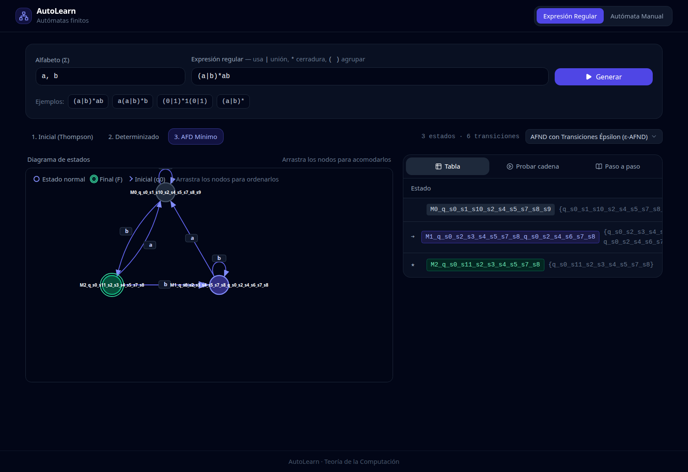


### Figura 2. Explicación del algoritmo de Moore

El panel Paso a paso muestra las particiones y operaciones de minimización. Esta evidencia complementa la prueba de que el resultado contiene tres estados.

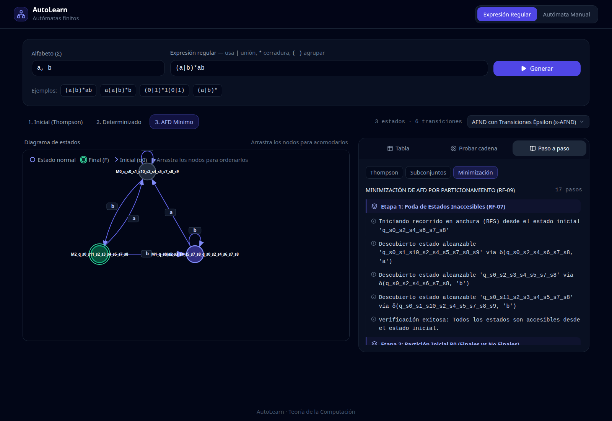


### Figura 3. Simulación exitosa

Sobre el AFD mínimo, se ingresó `aab` y se avanzó hasta el final. Resultado observado: Cadena aceptada.

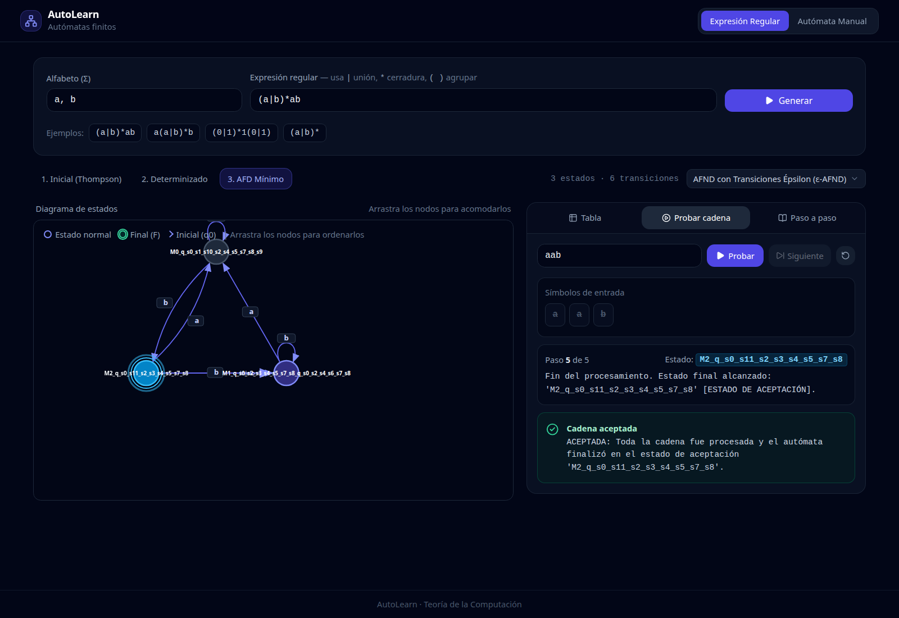


### Figura 4. Simulación de rechazo

Se ingresó `aba` en el mismo AFD y se avanzó hasta el veredicto. Resultado observado: Cadena rechazada.

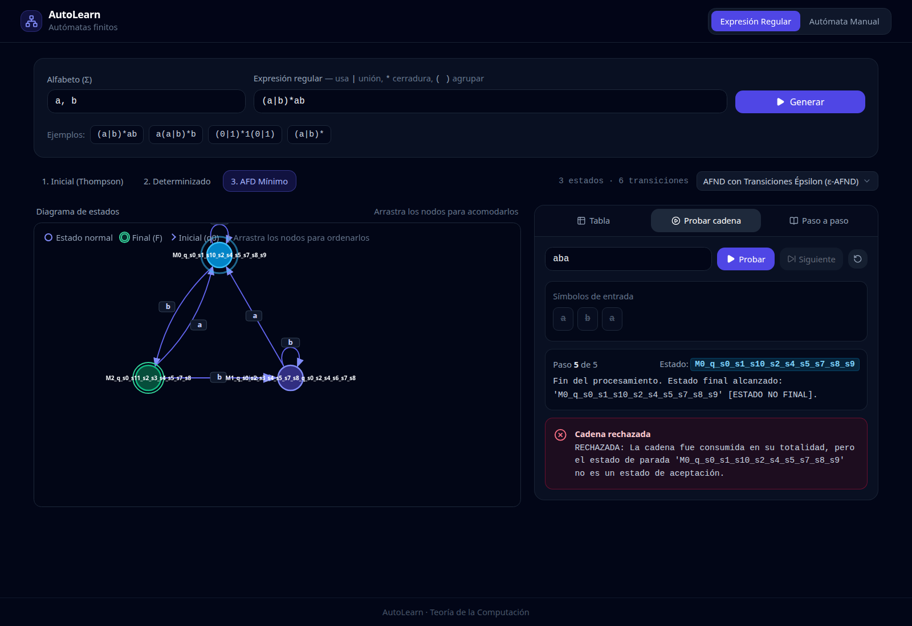


### Figura 5. Validación de alfabeto duplicado

Se ingresó `a, a` y se pulsó Generar. Se mostró el error por duplicados. El resultado anterior permanece visible; no corresponde a una nueva transformación de la entrada inválida.

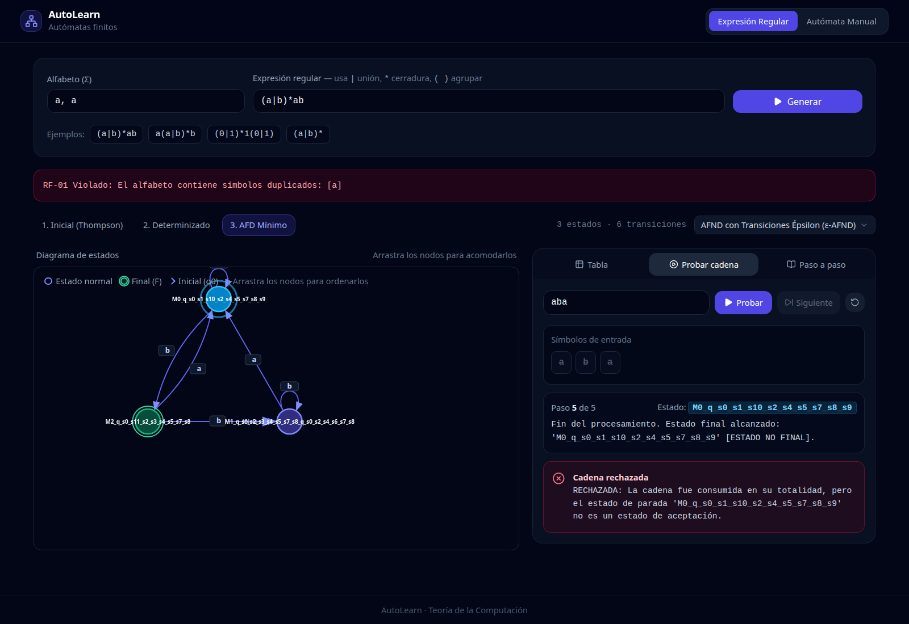


### Figura 6. Entrada manual de ε-AFND

Se cargó el ejemplo AFND con ε y se analizó. El mínimo completo contiene tres estados, incluido el rechazo.

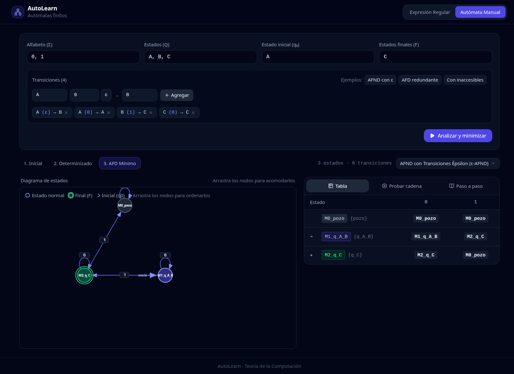


### Figura 7. Protección del simulador

Se seleccionó la etapa Inicial del AFND y Probar cadena. El sistema solicitó seleccionar Determinizado o AFD Mínimo, sin emitir un veredicto incorrecto.

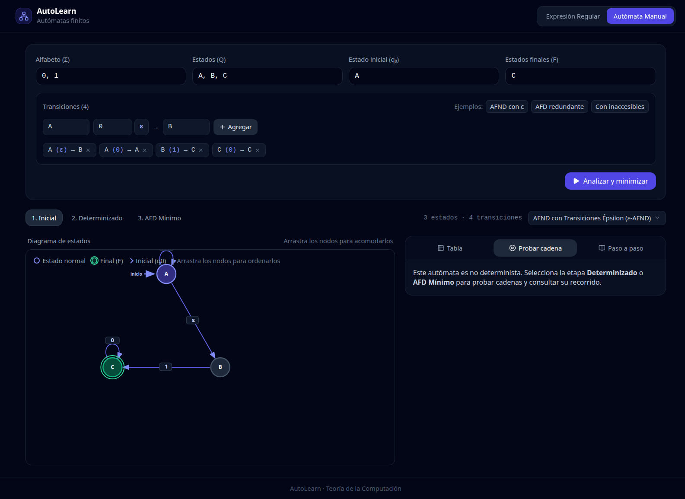


### Figura 8. Minimización de entrada determinista

El ejemplo AFD redundante se procesó hasta un mínimo de cuatro estados. La entrada no requiere determinización.

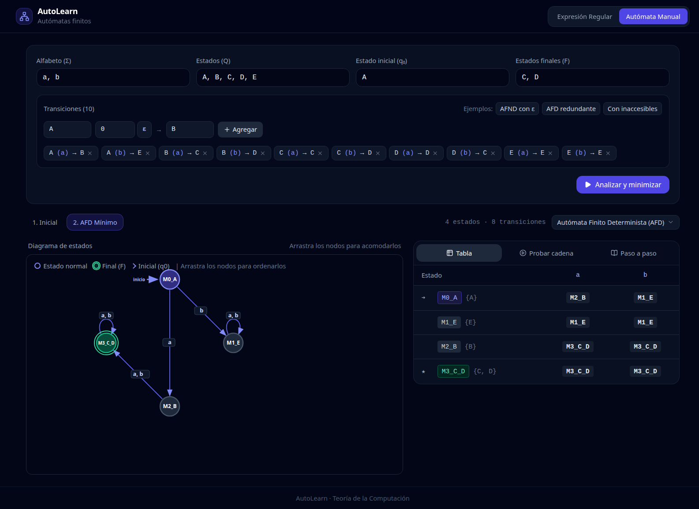


### Figura 9. Eliminación de estados inaccesibles

Se cargó Con inaccesibles y se abrió Paso a paso. La traza identifica `q_inacc`; las pruebas del motor verifican la poda y la conservación del lenguaje.

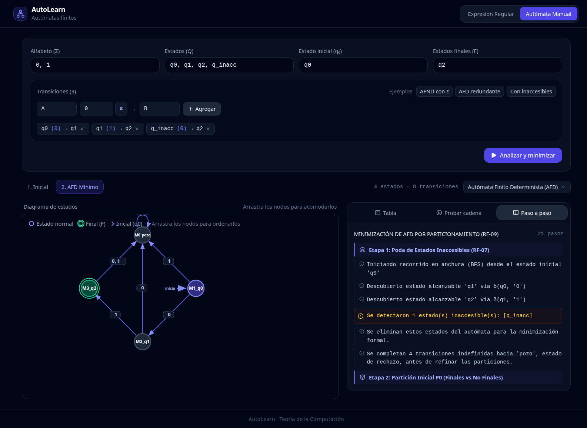


### Figura 10. Estado final inexistente

Se indicó `Z` como final sin registrarlo en Q. Se observó un mensaje de error que identifica Z. Los resultados previos pueden seguir visibles.

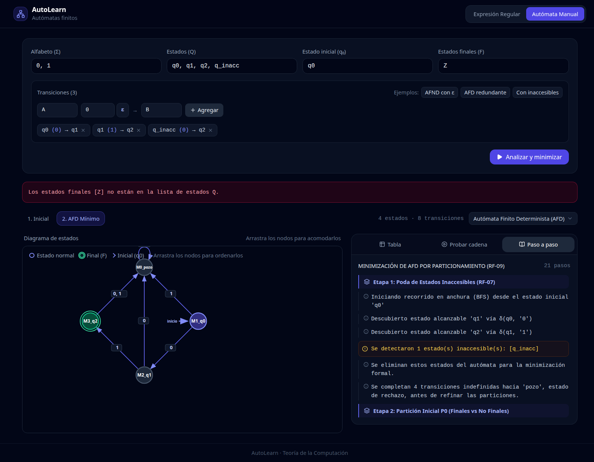


### Figura 11. Vista de pantalla estrecha

La captura de 390 píxeles permite revisar los formularios y el apilamiento de paneles. Se observa recorte del grafo por sus coordenadas fijas; esta imagen documenta una limitación y no certifica adaptación completa a móvil.

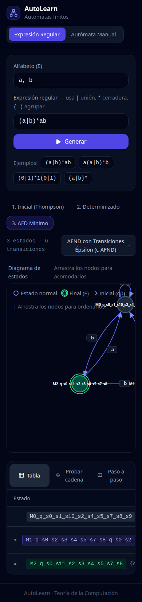


## 8. Registros de pruebas

Se conservaron las salidas de los comandos, su fecha UTC y el código de salida. Un código cero indica finalización correcta.


### motor-web

Registro original: [evidencias/motor-web.txt](evidencias/motor-web.txt).

```text
Comando: npm test
Fecha UTC: 2026-11-16T00:38:15.434043+00:00
Código de salida: 0


> automata-educativo@1.0.0 test
> node tests/web-engine.mjs

AFND generados: 100; comparaciones contra exploración independiente: 12600.
Motor web: validaciones, poda, AFD parcial y 3570 comparaciones de cadenas aprobadas.

```


### compilacion

Registro original: [evidencias/compilacion.txt](evidencias/compilacion.txt).

```text
Comando: npm run build
Fecha UTC: 2026-11-16T00:38:22.679734+00:00
Código de salida: 0


> automata-educativo@1.0.0 build
> tsc && vite build

vite v5.4.21 building for production...
transforming...
✓ 2092 modules transformed.
rendering chunks...
computing gzip size...
dist/index.html                   0.84 kB │ gzip:  0.48 kB
dist/assets/index-C4jj0TCw.css   19.75 kB │ gzip:  4.59 kB
dist/assets/index-o_tmHtZJ.js   202.77 kB │ gzip: 62.08 kB
✓ built in 3.32s

```


### casos-academicos

Registro original: [evidencias/casos-academicos.txt](evidencias/casos-academicos.txt).

```text
Comando: python3 test_runner.py
Fecha UTC: 2026-11-16T00:38:22.753882+00:00
Código de salida: 0


==================== TEST CASO 1: Modalidad A (Regex) ====================
[OK] Thompson generado con 12 estados.
[OK] AFD Determinizado con 4 estados.
[OK] AFD Mínimo con 3 estados. Estados finales: {'M_q_s0_s11_s2_s3_s4_s5_s7_s8'}
[OK] Simulación RF-12 validada: 'aab' aceptada, 'aba' rechazada.
CASO 1 APROBADO CON ÉXITO.

==================== TEST CASO 2: Modalidad B (AFND con ε) ====================
[OK] Tipo detectado: Autómata Finito No Determinista con Transiciones Épsilon (ε-AFND)
[OK] AFD Determinizado con 2 estados.
[OK] AFD Mínimo con 3 estados.
[OK] Simulación RF-12 validada: '0010' aceptada, '11' rechazada.
CASO 2 APROBADO CON ÉXITO.

==================== TEST CASO 3: Modalidad B (AFD Redundante) ====================
[OK] Tipo detectado: Autómata Finito Determinista (AFD)
[OK] AFD Mínimo con 4 estados (C y D fusionados).
CASO 3 APROBADO CON ÉXITO.

>>> TODOS LOS CASOS DE PRUEBA ACADÉMICOS EN PYTHON HAN SIDO VALIDADOS EXITOSAMENTE <<<

```


### regresiones-python

Registro original: [evidencias/regresiones-python.txt](evidencias/regresiones-python.txt).

```text
Comando: python3 -m unittest discover -s tests -v
Fecha UTC: 2026-11-16T00:38:23.308604+00:00
Código de salida: 0

test_aliases_and_whitespace (test_extended.ExtendedTests.test_aliases_and_whitespace) ... ok
test_colliding_state_names (test_extended.ExtendedTests.test_colliding_state_names) ... ok
test_empty_word_and_partial_dfa (test_extended.ExtendedTests.test_empty_word_and_partial_dfa) ... ok
test_generated_nfa (test_extended.ExtendedTests.test_generated_nfa) ... ok
test_manual_invalid_inputs (test_extended.ExtendedTests.test_manual_invalid_inputs) ... ok
test_regex_languages (test_extended.ExtendedTests.test_regex_languages) ... ok
test_explicit_concatenation (test_regressions.RegressionTests.test_explicit_concatenation) ... ok
test_invalid_syntax (test_regressions.RegressionTests.test_invalid_syntax) ... ok
test_nondeterministic_input (test_regressions.RegressionTests.test_nondeterministic_input) ... ok
test_partial_empty_language (test_regressions.RegressionTests.test_partial_empty_language) ... ok
test_simulator_rejects_nondeterminism (test_regressions.RegressionTests.test_simulator_rejects_nondeterminism) ... ok
test_unknown_final_state (test_regressions.RegressionTests.test_unknown_final_state) ... ok

----------------------------------------------------------------------
Ran 12 tests in 0.444s

OK

```


## 9. Evaluación y límites de la entrega

Los casos incluidos finalizaron correctamente: 32.340 comparaciones automáticas de aceptación entre ambos motores, pruebas específicas de validación, tres escenarios académicos y nueve comprobaciones de texto en navegador. La compilación de producción finalizó correctamente. Las capturas muestran además las particiones y la presentación en escritorio y móvil.

Durante la revisión se corrigieron las colisiones de nombres al determinizar y la normalización de espacios en Python; las pruebas conservan casos para esos fallos. También se validan los estados finales ajenos a Q y se impide simular AFND con un simulador diseñado para AFD.

Persisten límites conocidos:

- Las pruebas de cadenas son acotadas, no una demostración formal para toda entrada posible.
- Los identificadores generados pueden ser muy largos: la tabla requiere desplazamiento horizontal y las etiquetas del grafo pueden solaparse.
- En pantallas estrechas el grafo puede quedar recortado porque utiliza coordenadas fijas; la captura móvil lo evidencia.
- Después de una entrada inválida se muestra el error, pero pueden permanecer los resultados anteriores. Se deben interpretar como resultados de la última entrada válida.
- El formato operativo es por caracteres; no se implementa un analizador de tokens de varias letras.
- No se verificaron el despliegue externo, la interacción de Tkinter ni el uso del mismo lenguaje de los microproyectos anteriores.

## 10. Guion sugerido para la sustentación

1. Presentar objetivo y las dos modalidades de entrada.
2. Construir `(a|b)*ab` con Σ = {a,b}; explicar Thompson y la clausura ε.
3. Mostrar el AFD determinizado y las correspondencias con los estados originales.
4. Explicar finales/no finales y refinamiento hasta obtener tres estados mínimos.
5. Simular `aab` y `aba`, justificando aceptación y rechazo.
6. Cargar el ε-AFND manual, explicar por qué no es determinista y revisar su conversión.
7. Cargar el AFD redundante y justificar la fusión de C y D.
8. Mostrar la poda de `q_inacc` y las validaciones por duplicados y finales inexistentes.
9. Mostrar las evidencias automáticas, los resultados y las limitaciones registradas.

La exposición oral debe realizarla el equipo. Completar los datos de portada antes de presentar el documento.
